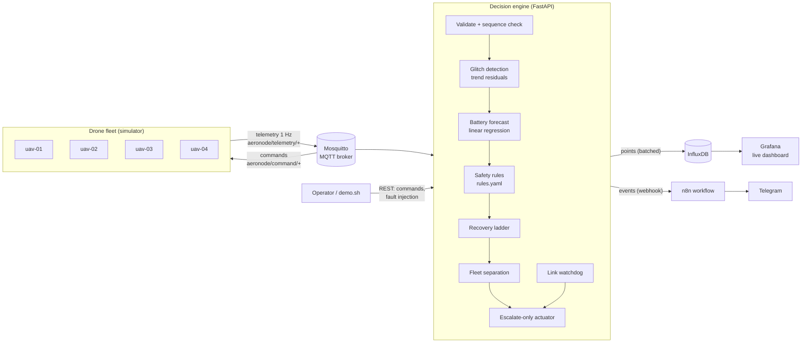

# AeroNode — Real-Time Autonomous System Framework

[](../../actions/workflows/ci.yml)


AeroNode is an event-driven platform that ingests live telemetry from a UAV fleet, decides **autonomously** what to do when something goes wrong, acts on the drones, and makes everything observable.

A simulated fleet streams telemetry over MQTT. A Python decision engine validates every frame, filters out bad sensor data, predicts battery exhaustion, enforces safety rules and fleet separation, and self-heals faulty sensors. It sends commands back to the drones in under a millisecond. Every reading and decision lands in **InfluxDB**, is visualised live in **Grafana**, and is routed as an alert through an **n8n** workflow. The whole stack starts with one `docker compose up`.

```
fault on uav-03  ->  BATTERY_SUDDEN_DROP  ->  forecast: home is too far  ->  RTL sent  ->  Telegram alert
                     (detected in 2 frames)    (linear regression on drain)  (< 1 ms)      (via n8n)
```

---

## Architecture



| Service | Role | URL |
|---|---|---|
| `simulator` | 4 UAVs with kinematics, battery and thermal models, and 8 injectable faults | — |
| `mosquitto` | MQTT message bus (telemetry in, commands out) | `localhost:1883` |
| `engine` | Decision engine + REST API (Swagger docs at `/docs`) | http://localhost:8000/docs |
| `influxdb` | Time-series storage for telemetry, events, forecasts and engine metrics | http://localhost:8086 |
| `grafana` | Pre-provisioned fleet dashboard | http://localhost:3000 |
| `n8n` | Alert routing workflow (auto-imported and activated) | http://localhost:5678 |

---

## Features

**Autonomous decisions**
- **Safety rules** from `config/rules.yaml`: battery (warn / RTL / land), circular geofence, altitude ceiling, motor temperature, link quality. Thresholds can be tuned without code changes and hot-reloaded via `POST /config/reload`.
- **Predictive battery failsafe**: fits a least-squares line to the last 60 s of battery readings and compares *time-to-reserve* with *time-to-home*. A drone far from home on a fast drain comes back early; one hovering nearby isn't recalled at an arbitrary percentage.
- **Fleet separation**: every pair of airborne drones is checked in 3D. The drone closing in faster is told to `HOLD`. It is released automatically once separation has been restored for a few seconds.
- **Link watchdog**: raises `LINK_LOST` when a drone goes silent and measures downtime when it comes back.

**Reliability**
- **Don't act on bad data.** Each reading is compared with a short-horizon trend prediction. Glitches are flagged, kept out of the baseline, and replaced by the estimate before any rule runs, so a spiking altimeter can't trigger a false `DESCEND`.
- **Glitch vs real change.** Off-trend readings that agree with each other (a battery cell dropping out) are accepted as a *level shift*. Readings that don't agree with each other (a noisy sensor) stay glitches.
- **Self-healing.** Repeated glitches start a recovery ladder: `RESET_SENSOR`, verify, then `REBOOT`, verify, and if it is still faulty, bring the drone home. Time to recovery is recorded.
- **Escalate-only actuation.** `DESCEND < HOLD < RTL < LAND`: a pending landing is never downgraded by a milder rule. Commands are re-sent if the drone doesn't comply, and alerts have cooldowns, so there's no flapping and no command spam.
- **Never block the control loop.** MQTT callbacks only enqueue messages and a worker thread decides. InfluxDB writes are batched in the background, and n8n delivery has its own queue with retries and backoff. If storage or alerting is down, the fleet is still protected, and the engine reports `degraded` on `/health`.
- **Out-of-order frames are dropped and gaps are counted** (per-drone sequence numbers).

**Operations**
- One-command deployment with health checks, restart policies and dependency ordering.
- Grafana dashboard provisioned as code (`scripts/build_dashboard.py`): live map, fleet status, decision log, telemetry, battery-margin forecast, and engine latency/throughput.
- **Chaos API** (`POST /drones/{id}/fault`) plus `scripts/demo.sh`, which walks through every failure scenario live.
- 53 automated tests plus CI (lint, tests, dashboard drift check, Docker build).

---

## Quick start

Requirements: Docker with Compose v2.

```bash
git clone https://github.com/<you>/aeronode.git
cd aeronode
cp .env.example .env          # defaults work for a local demo
docker compose up -d --build  # or: make up
```

After about 30 seconds:

- **Grafana**: http://localhost:3000 (login `admin` / `change-me-grafana`). The AeroNode dashboard is the home page.
- **API docs**: http://localhost:8000/docs
- **Fleet status**: `curl localhost:8000/drones`

Then break things on purpose:

```bash
./scripts/demo.sh            # all scenarios, ~8 minutes
./scripts/demo.sh battery    # just one
```

### Telegram alerts (optional)

1. Create a bot with [@BotFather](https://t.me/BotFather) and copy the token.
2. Send your bot a message, then open `https://api.telegram.org/bot<TOKEN>/getUpdates` and copy `chat.id`.
3. Put both in `.env` (`TELEGRAM_BOT_TOKEN`, `TELEGRAM_CHAT_ID`) and run `docker compose up -d`.

Critical alerts arrive with sound and warnings arrive silently. Without a token, the workflow still runs and logs every event (open n8n → *Executions*). The first time you open n8n it asks you to create a local owner account.

---

## Failure scenarios

Every scenario can be triggered from the demo script or the API.

| Fault injected | What the engine sees | Autonomous response |
|---|---|---|
| `sensor_spike` | Altitude/temperature readings off-trend by 40–90 m | Ignores bad readings, raises `SENSOR_GLITCH`, sends `RESET_SENSOR`, verifies, then `RECOVERY_SUCCEEDED` |
| `sensor_stuck` | Same, but a reset doesn't fix it | Escalates `RESET_SENSOR` → `REBOOT` → recovered (RTL if the ladder is exhausted) |
| `battery_drop` | 35 % instant drop, then 3× drain | `BATTERY_SUDDEN_DROP` (level shift, not a glitch), then forecast says home is too far, so `RTL` |
| `flyaway` | Drone heading straight out | `GEOFENCE_WARNING` at 850 m, `GEOFENCE_BREACH` at 1000 m, then `RTL` |
| `altitude_runaway` | Steady climb past 120 m | `ALTITUDE_LIMIT`, then `DESCEND` |
| `motor_overheat` | Motor temperature climbing | `MOTOR_TEMP_HIGH` at 70 °C, then `LAND` at 85 °C |
| `intercept` | One drone chasing another | `PROXIMITY_CONFLICT`: faster-closing drone `HOLD`s, then `RESUME` when clear |
| `signal_loss` | Telemetry stops | `LINK_LOST` after 5 s, then `LINK_RESTORED` with measured downtime |

Real output from `./scripts/demo.sh battery`:

```
3. Battery cell failure -> sudden drop detected, predictive return-to-home
  -> injected 'battery_drop' on uav-04
  19:21:57  uav-04  warning  SENSOR_GLITCH            battery=37.7 looks wrong (off-trend by -35.2 (limit 4.0)); using 73.0
  19:21:59  uav-04  critical BATTERY_SUDDEN_DROP      battery fell 36% at once (73% -> 37%)
  19:22:00  uav-04  warning  BATTERY_PREDICTIVE_RTL   reserve in 15s but home is 99s away - returning early
  19:22:00  uav-04  info     COMMAND_SENT             RTL (predictive_battery)
  19:22:01  uav-04  info     MODE_CHANGED             MISSION -> RTL
```

The first off-trend reading is treated as a possible glitch. Two frames later the readings are still consistent, so the engine accepts the drop as real, re-forecasts, and sends the drone home. The 37% battery left is above the fixed 25% threshold, so a simple rule would have kept it flying.

---

## How a decision is made

For every telemetry frame (`engine/aeronode/engine.py`):

1. **Validate** the payload (Pydantic: ranges, types). Drop it if `seq` is not newer than the last frame, and count gaps as lost frames.
2. **Bookkeeping.** Track link restoration and mode changes. A new flight or landing resets that drone's baselines and clears old orders.
3. **Glitch detection** on `alt`, `motor_temp` and `battery` (`anomaly.py`). The residual is `reading − (last + slope·dt)`. It is anomalous if `|residual| > max(5σ, floor)`. Untrusted values are replaced by the estimate.
4. **Battery forecast** (`predictor.py`). `must_return = time_to_reserve < 1.3 × (distance/8 m/s + alt/2.5 m/s)`.
5. **Rules** (`rules.py`). These are pure functions of the *trusted* frame, which makes them trivial to unit-test.
6. **Recovery** (`recovery.py`). A state machine `IDLE → RECOVERING(step n) → IDLE | FAILED`.
7. **Separation** (`proximity.py`). Pairwise 3D check, with the yielding drone chosen by closing speed.
8. **Act** with escalate-only logic, cooldowns and re-sends. **Record** to InfluxDB and **alert** through n8n.

Measured in a full demo run: **~0.09 ms median, ~0.26 ms p95** per frame, 0 dropped messages (see `/metrics` or the Grafana *Engine performance* panel).

---

## API

| Method | Path | Description |
|---|---|---|
| `GET` | `/health` | Broker / database / alerting status (`ok` or `degraded`) |
| `GET` | `/metrics` | Throughput, latency percentiles, queue depth, write/alert counters |
| `GET` | `/drones` | Every drone: last telemetry, mode, current order, battery forecast, recovery state |
| `GET` | `/drones/{id}` | One drone |
| `GET` | `/events?limit=&drone_id=&severity=` | Recent decisions and events |
| `POST` | `/drones/{id}/command` | Manual command: `RTL`, `LAND`, `HOLD`, `RESUME`, `DESCEND`, `RESET_SENSOR`, `REBOOT` |
| `POST` | `/drones/{id}/fault` | Chaos testing: `{"type": "flyaway"}`, `{"type": "intercept", "target": "uav-02", "duration": 45}` |
| `GET` | `/config/rules` | Active rules |
| `POST` | `/config/reload` | Reload `config/rules.yaml` without restarting |

Set `API_KEY` in `.env` to require an `X-API-Key` header on the `POST` endpoints.

**MQTT topics**

| Topic | Direction | Payload |
|---|---|---|
| `aeronode/telemetry/<id>` | drone → engine | `{drone_id, ts, seq, lat, lon, alt, battery, speed, heading, motor_temp, signal, mode, wp_index}` |
| `aeronode/command/<id>` | engine → drone | `{command, id, ts}` |
| `aeronode/ack/<id>` | drone → engine | `{command, id, accepted, reason, mode}` |
| `aeronode/fault/<id>` | engine → simulator | `{type, duration?, target?}` |

---

## Project structure

```
aeronode/
├── docker-compose.yml          # 6 services + one-shot n8n workflow import
├── .env.example
├── config/rules.yaml           # every threshold the engine uses
├── engine/
│   ├── aeronode/
│   │   ├── api.py              # FastAPI app + process wiring
│   │   ├── bus.py              # MQTT in/out, worker thread, back-pressure
│   │   ├── engine.py           # decision pipeline
│   │   ├── anomaly.py          # trend-residual glitch detection, level shifts
│   │   ├── predictor.py        # battery regression forecast
│   │   ├── rules.py            # pure safety rules
│   │   ├── recovery.py         # self-healing state machine
│   │   ├── proximity.py        # fleet separation
│   │   ├── storage.py          # batched InfluxDB writer
│   │   ├── notifier.py         # n8n webhook with retry/backoff
│   │   └── models.py
│   └── tests/                  # 47 tests
├── simulator/
│   ├── aeronode_sim/           # drone model, fleet, MQTT loop
│   └── tests/
├── grafana/                    # datasource + dashboard provisioning
├── n8n/workflows/              # alert workflow (imported on start)
├── mosquitto/mosquitto.conf
└── scripts/
    ├── demo.sh                 # guided fault-injection walkthrough
    └── build_dashboard.py      # dashboard-as-code generator
```

## Development

```bash
python -m venv .venv && source .venv/bin/activate
pip install -r engine/requirements-dev.txt -r simulator/requirements.txt
make test                         # or: cd engine && pytest

# run without Docker (needs any MQTT broker on localhost:1883)
cd engine && uvicorn aeronode.api:app --reload
cd simulator && python -m aeronode_sim.main
```

## Limitations and next steps

- The simulator is a kinematic model, not flight dynamics. Next step: replace it with PX4 SITL over MAVLink, keeping the same MQTT contract.
- The broker allows anonymous access for local use. For deployment, add TLS, per-device credentials and topic ACLs.
- Engine state is in memory, so a restart relearns baselines within about 10 seconds. A larger fleet would shard drones across engine instances by `drone_id`.
- Separation is pairwise O(n²), which is fine for tens of drones. Hundreds would need a spatial index (geohash grid).
